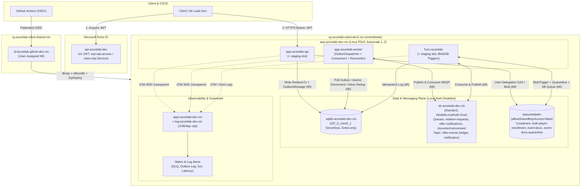

# AzureLab — Enterprise .NET 10 Cloud Architecture Lab

Production-grade reference workload built on **.NET 10**, **Azure App Service**, **Azure Functions (Isolated)**, **Azure Service Bus**, **Azure SQL Serverless**, **Azure Blob Storage**, and **Azure Monitor OpenTelemetry**, provisioned via **Bicep** and **GitHub Actions OIDC** with zero secrets, keys, or passwords.

## Architecture Diagram (Azure Deployment)



## Quick Start

### 1. Local Development
```powershell
# 1. Start local dependencies (SQL Server, Azurite, Service Bus Emulator, Postgres pgvector)
docker compose -f infra/local/docker-compose.yml up -d

# 2. Configure Entra ID settings for API authentication (zero secrets in repo)
dotnet user-secrets set "AzureAd:TenantId" "<your-tenant-id>" --project AzureLabs.Api
dotnet user-secrets set "AzureAd:ClientId" "<api-app-client-id>" --project AzureLabs.Api

# 3. Apply EF Core migrations & run
dotnet ef database update --project AzureLab.Infrastructure --startup-project AzureLabs.Api
dotnet run --project AzureLabs.Api
dotnet run --project AzureLab.Worker
```

### 2. Azure Provisioning (Bicep)
```powershell
$env:AZURELAB_OWNER = 'ndvd'
$env:AZURE_TENANT_ID = '<tenant-id>'
$env:AZURELAB_API_CLIENT_ID = '<api-app-client-id>'
$env:ALERT_EMAIL = '<alert-email>'
$env:AZURELAB_SQL_ADMIN_LOGIN = '<admin-upn>'
$env:AZURELAB_SQL_ADMIN_OID = '<admin-object-id>'

az deployment group what-if -g rg-azurelab-ndvd-dev2-cin `
  -f infra/bicep/main.bicep -p infra/bicep/params/dev.bicepparam
```

### 3. Documentation & Evidence
- **Architecture Decision Records (ADRs):** [`docs/adr/`](file:///d:/2026/AzureLabs/docs/adr/)
- **Operational Runbooks:** [`docs/runbooks.md`](file:///d:/2026/AzureLabs/docs/runbooks.md)
- **Cloud Week 1 Engineering Log:** [`docs/cloud-week1-log.md`](file:///d:/2026/AzureLabs/docs/cloud-week1-log.md)
- **Daily Handoffs & Evidence:** [`docs/handoffs/`](file:///d:/2026/AzureLabs/docs/handoffs/)
- **Interview Q&A Bank:** [`docs/interview-qa.md`](file:///d:/2026/AzureLabs/docs/interview-qa.md)
