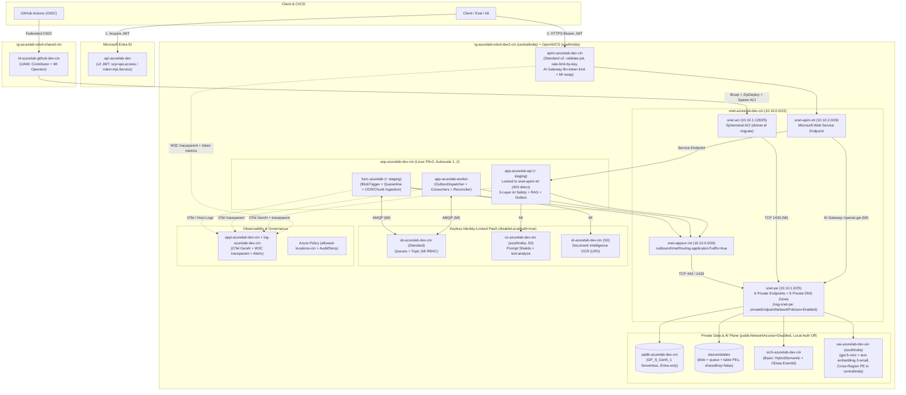

# AzureLab — Enterprise .NET 10 Cloud Architecture Lab

## About

**AzureLab** is an end-to-end, production-grade cloud & AI reference architecture on **.NET 10** and **Azure**, engineered with **zero secrets, connection-string passwords, or API keys** from local development through CI/CD and runtime:

- **Zero-Secret Identity & Access:** System-Assigned Managed Identities with narrow resource/queue/container-scoped RBAC, local/shared-key auth disabled across Storage, Service Bus, SQL, and AI services, plus Entra ID v2 JWT + per-event ACL authorization ([ADR 001](docs/adr/001-identity-and-rbac.md), [ADR 003](docs/adr/003-authentication-and-authorization.md)).
- **Resilient Asynchronous Core:** Transactional SQL Outbox (`UPDLOCK, READPAST` leases) → Azure Service Bus → idempotent Inbox consumers, atomic SQL inventory updates (zero oversells under burst load), `RedeemReconciler` self-healing, and composite queue + CPU autoscale ([ADR 005](docs/adr/005-scaling-and-failure-handling.md)).
- **Enterprise RAG & 3-Layer AI Safety:** Config-switched seams (`Ollama`/`pgvector` locally; `Azure OpenAI gpt-5-mini`, `Azure AI Search` `HybridSemantic` L2 reranking, and `Document Intelligence` OCR in Azure) guarded by deterministic code caps, `Azure AI Content Safety` Prompt Shields (fail-closed input + surgical poisoned-chunk drop), and two-phase human confirmation for tool mutations ([ADR 006](docs/adr/006-ai-region-and-models.md)–[ADR 008](docs/adr/008-safety-layers.md)).
- **Private Networking & API/AI Gateway:** VNet isolation with 6 Private Endpoints + Private DNS zones (including cross-region Private Link), ephemeral VNet ACI containers for private EF Core migrations, and **APIM Standard v2** enforcing edge JWT/rate limits, `llm-token-limit` AI Gateway quotas, and Service-Endpoint-locked App Service ingress ([ADR 009](docs/adr/009-network-isolation.md), [ADR 010](docs/adr/010-api-gateway.md)).
- **End-to-End Observability & Keyless CI/CD:** W3C `traceparent` continuity across HTTP → SQL Outbox → Service Bus → Worker/Functions with OpenTelemetry + Azure Monitor KQL/metric alerts, provisioned via **Bicep** and **GitHub Actions OIDC** ([ADR 002](docs/adr/002-deploy-pipeline-and-slots.md), [ADR 004](docs/adr/004-observability-and-alerting.md)).

## Architecture Diagram (Azure Deployment — Week 1 + Week 2 Full Private Topology)



## Quick Start

### 1. Local Development
```powershell
# 1. Start local dependencies (SQL Server, Azurite, Service Bus Emulator, Postgres pgvector)
docker compose -f infra/local/docker-compose.yml up -d

# 2. Configure Entra ID settings for API authentication (zero secrets in repo)
dotnet user-secrets set "AzureAd:TenantId" "<your-tenant-id>" --project AzureLabs.Api
dotnet user-secrets set "AzureAd:ClientId" "<api-app-client-id>" --project AzureLabs.Api

# 3. Apply EF Core migrations & run
dotnet ef database update --project AzureLab.Data --startup-project AzureLabs.Api
dotnet run --project AzureLabs.Api
dotnet run --project AzureLab.Worker
```

### 2. Azure Provisioning (Bicep) & CI/CD Toggle
> **Note (Lab Teardown Mode):** Live Azure `what-if` and deployment jobs in [`.github/workflows/infra.yml`](.github/workflows/infra.yml) and [`.github/workflows/apps.yml`](.github/workflows/apps.yml) are gated by the GitHub Repository Variable **`AZURE_DEPLOY_ENABLED`**. Leave it unset or `false` while Azure resources are deleted (offline Bicep & .NET CI builds still run); set `AZURE_DEPLOY_ENABLED=true` in **Settings → Secrets and variables → Actions → Variables** to re-enable live `what-if` and deployments.

```powershell
$env:AZURELAB_OWNER = 'ndvd'
$env:AZURE_TENANT_ID = '<tenant-id>'
$env:AZURELAB_API_CLIENT_ID = '<api-app-client-id>'
$env:ALERT_EMAIL = '<alert-email>'
$env:AZURELAB_SQL_ADMIN_LOGIN = '<admin-upn>'
$env:AZURELAB_SQL_ADMIN_OID = '<admin-object-id>'

az deployment group what-if -g rg-azurelab-ndvd-dev2-cin `
  -f infra/bicep/main.bicep -p infra/bicep/params/dev.bicepparam
```

### 3. Documentation & Evidence
- **Architecture Decision Records (ADRs 001–011):** [`docs/adr/`](docs/adr/)
- **Load, Concurrency & Resilience Lab Results:** [`infra/local/load/RESULTS.md`](infra/local/load/RESULTS.md) | [`infra/local/load/README.md`](infra/local/load/README.md)
